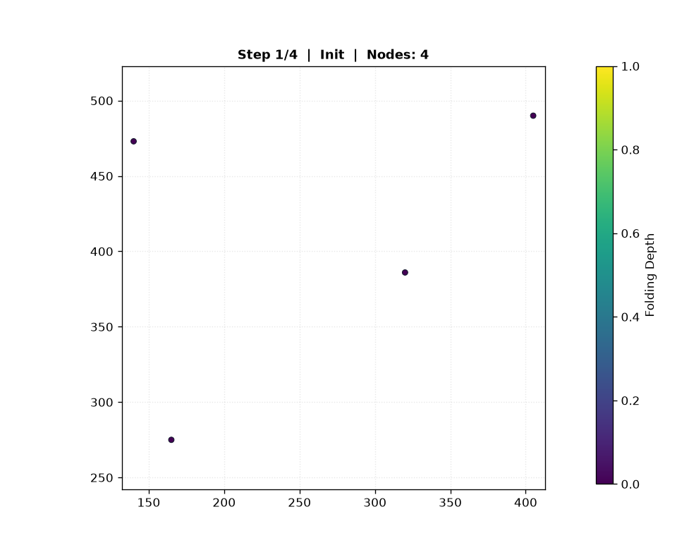
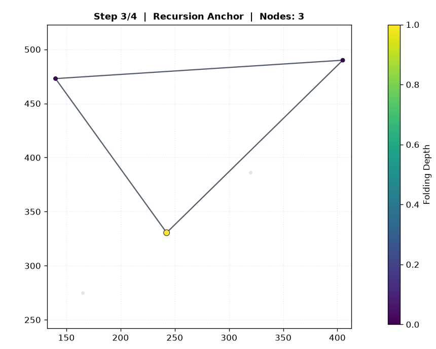
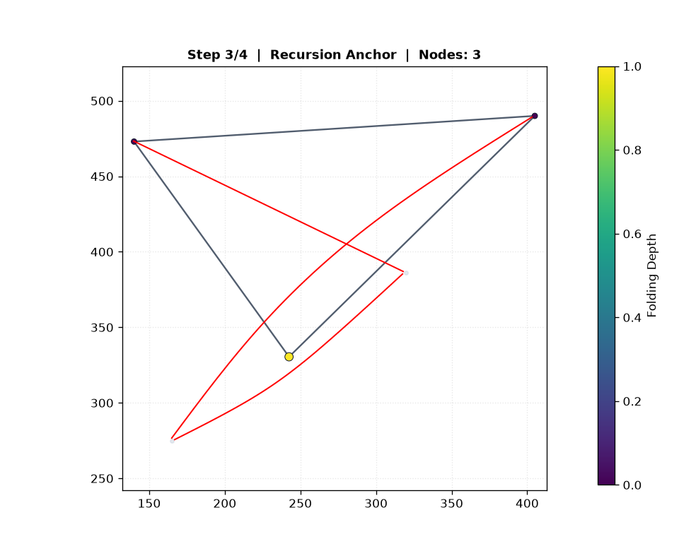
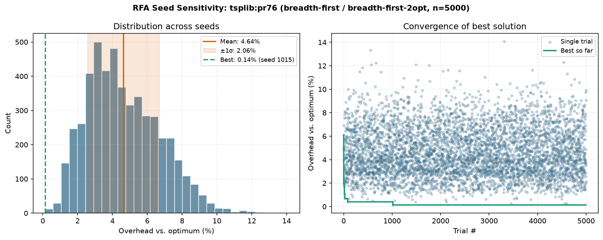
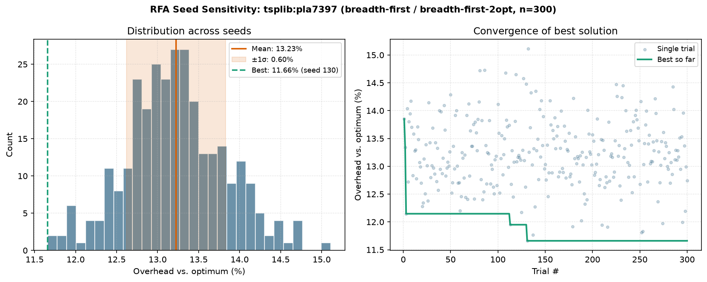
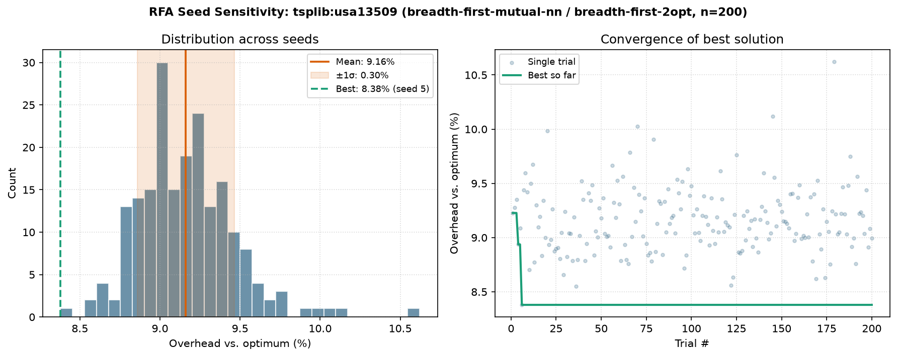

# rfa-tsp <!-- omit from toc -->

[](https://www.python.org/downloads/)
[](LICENSE)
[](https://github.com/rsnitsch/rfa-tsp/actions/workflows/pip-audit.yml)
[](https://github.com/rsnitsch/rfa-tsp/actions/workflows/test.yml)
[](https://github.com/astral-sh/uv)
[](https://github.com/astral-sh/ruff)

The **recursive-fold-algorithm** (RFA) is a recursive algorithm for the metric **travelling salesman problem** (TSP).
The objective of the TSP is to find a round trip through a number of cities/locations (more generally referred to as
**nodes**). The round trip should be as short as possible. The TSP is a very hard problem with difficult computational
properties (TSP belongs to the NP-hard problem class).

Recursive algorithms naturally split a problem into a series of smaller steps that are easier to solve individually. As
such, they're often very elegant.

## Contents <!-- omit from toc -->

- [Visualization](#visualization)
- [Recursion concept](#recursion-concept)
  - [Folding strategies](#folding-strategies)
  - [Unfolding strategies](#unfolding-strategies)
- [Algorithmic properties](#algorithmic-properties)
  - [Seed sensitivity](#seed-sensitivity)
    - [Key observations](#key-observations)
  - [Time complexity](#time-complexity)
    - [Empirical scaling](#empirical-scaling)
    - [Algorithmic analysis](#algorithmic-analysis)
- [Usage](#usage)
  - [Processing a single TSPLIB instance](#processing-a-single-tsplib-instance)
  - [Processing a random TSP instance](#processing-a-random-tsp-instance)
  - [Visualizing the steps of the algorithm](#visualizing-the-steps-of-the-algorithm)
  - [Benchmarking](#benchmarking)
- [License](#license)

## Visualization

This is how the RFA finds a route for the TSPLIB problem `pr76`:


<details>
<summary>Show command that was used to generate the above animation</summary>

```console
❯ uv run rfa-tsp tsplib:pr76 --seed 16 --export docs/rfa-tsp_tsplib_pr76.gif --export-fps 2-6
INFO | Instance:           tsplib:pr76 (76 nodes)
INFO | Folding strategy:   breadth-first
INFO | Unfolding strategy: breadth-first-2opt
INFO | Post-uncross:       False
INFO | Seed:               16
INFO | Total length:       109335
INFO | Optimal route:      108159 (overhead of RFA route: +1.09%)
INFO | Runtime:            0.021s
INFO | Exporting 148 unique frames to docs\rfa-tsp_tsplib_pr76.gif (fps=2-6, dpi=120)...
INFO | Export finished: docs\rfa-tsp_tsplib_pr76.gif
```

</details>

## Recursion concept

RFA exploits the fact that the TSP can be trivially solved if there are only 3 nodes, because only a single round trip
route exists for 3 nodes. The solution, a triangle, is self-evident:


This **trivial case** is the **recursion anchor** for the algorithm.

But how to deal with larger problem sizes? The answer is to **fold nodes**. Folding means that two nodes that are in
close proximity to each other are fused into an artificial new node. This new node gets placed in the middle between the
two original nodes and replaces them. By remembering the original nodes it is also possible to reverse such a folding
operation later on (referred to as **unfolding**). Of course, folded nodes can be folded again themselves (recursively).
These folding steps can be repeated until the problem size is reduced to a number of 3 nodes.

Let's consider the following TSP instance with 4 nodes:



We can pick a node and its nearest neighbor and fold them. The new node will be placed in the center and remember the
original nodes (the "children"):


At this point, the number of nodes is reduced to 3. This is the trivial case and a preliminary route can be constructed.
The best route for 3 nodes is a simple triangle:



Now we have to reverse the folding.

The key to RFA is that the nodes are now unfolded step by step. Each unfolding removes a node and replaces it with two
new nodes (the original child nodes from which the folded node was constructed). These new nodes can be inserted into
the preliminary route in two alternative orders only.

|              Bad choice (longer, intersecting)               |                     Good choice (shorter)                      |
| :----------------------------------------------------------: | :------------------------------------------------------------: |
|  |  |

It is trivial to calculate which option keeps the route shorter. Result:


The complete process can be described as follows:

- **Folding:** Pick a node and fold it with a neighboring node. Repeat folding nodes until the number of nodes has been
  reduced to 3.
- **Recursion anchor:** Create a preliminary round trip route through the 3 remaining nodes.
- **Unfolding:** Unfold the nodes until the original nodes have been restored. At each unfolding step, insert the new
  nodes in the preliminary route. Choose the insertion order that gives the shorter route length.

<!--
Images generated with:
uv run rfa-tsp random:default -n 4 -s 0 --export docs/rfa-tsp_concept.png
-->

### Folding strategies

- `breadth-first` (default): Randomly picks one of the least-folded nodes (minimum folding depth) and folds it with its
  nearest neighbor across all active nodes, keeping the folding tree balanced.
- `breadth-first-mutual-nn`: Like `breadth-first`, processes the least-folded nodes first to keep the folding tree
  balanced, but preferentially folds mutual nearest-neighbor pairs (two nodes that are each other's nearest neighbor),
  avoiding asymmetric pairings.
- `random-nn`: A very simple yet highly efficient method which randomly picks a node and folds it with the
  nearest-neighbor.
- `outside-in`: The node furthest from the center point is folded with its nearest-neighbor. The center point is only
  calculated once at the beginning.

### Unfolding strategies

- `breadth-first`: The list of folded nodes is processed repeatedly. During each iteration, only the nodes with the
  maximum depth are unfolded.
- `breadth-first-2opt` (default): Same as UnfoldingStrategyBreadthFirst, but after each unfolding step, a local 2-opt
  optimization around the inserted nodes is performed.

## Algorithmic properties

### Seed sensitivity

The `breadth-first` (default) and `random-nn` folding strategies select nodes to fold randomly. Consequently, the
quality of the resulting tour depends on the RNG seed.

To quantify how strongly RFA depends on the seed across different problem sizes, we can evaluate multiple consecutive
seeds (`--trials`) and compare a small instance (`tsplib:pr76`, 76 nodes) with large instances (`tsplib:pla7397`, 7,397
nodes; `tsplib:usa13509`, 13,509 nodes):

| Instance          |  Nodes | Trials | Mean overhead | Std. dev. ($\\sigma$) |   Best overhead    |
| :---------------- | -----: | -----: | :-----------: | :-------------------: | :----------------: |
| `tsplib:pr76`     |     76 |  5,000 |    +4.64%     |         2.06%         | +0.14% (seed 1015) |
| `tsplib:pla7397`  |  7,397 |    300 |    +13.23%    |         0.60%         | +11.66% (seed 130) |
| `tsplib:usa13509` | 13,509 |    200 |    +10.71%    |         0.31%         | +9.98% (seed 119)  |



<details>
<summary>Show plots for large instances (<code>pla7397</code>, <code>usa13509</code>)</summary>





</details>

#### Key observations

- **Variance shrinks with problem size:** On small instances (`pr76`), individual folding decisions have a large global
  impact, producing a wide, right-skewed distribution ($\\sigma = 2.06%$). On large instances (`pla7397`, `usa13509`),
  thousands of local folding steps average out, tightening the distribution into a narrow, roughly symmetric bell curve
  ($\\sigma = 0.31%$ on `usa13509`).
- **Multi-trial trade-off:** On small instances, a multi-trial sweep (`--trials 100`) can push the solution close to the
  optimum (`+0.14%` on `pr76`). On large instances, diminishing returns set in quickly (~0.7–1.6 percentage points gain
  over the mean), because the distribution is already tightly concentrated.
- **Single-run reliability at scale:** Conversely, the low variance on large instances means that even a single RFA run
  yields a highly predictable result without severe bad-luck outliers.

<details>
<summary>Show commands used to generate the above plots</summary>

```bash
uv run rfa-tsp tsplib:pr76 --trials 5000 --save-trials trial-pr76.json
uv run rfa-tsp-plot-trials trial-pr76.json --export docs/rfa-tsp-seed-sensitivity_tsplib-pr76.png

uv run rfa-tsp tsplib:pla7397 --trials 300 --save-trials trial-pla7397.json
uv run rfa-tsp-plot-trials trial-pla7397.json --export docs/rfa-tsp-seed-sensitivity_tsplib-pla7397.png

uv run rfa-tsp tsplib:usa13509 --trials 200 --save-trials trial-usa13509.json
uv run rfa-tsp-plot-trials trial-usa13509.json --export docs/rfa-tsp-seed-sensitivity_tsplib-usa13509.png
```

</details>

### Time complexity

#### Empirical scaling

Looking at the [benchmark results](#benchmarking) across TSPLIB instances spanning nearly two orders of magnitude in
size reveals a nearly constant runtime per node:

| Instance   | Nodes ($n$) | Mean runtime | Time per node |
| :--------- | ----------: | -----------: | ------------: |
| `pr1002`   |       1,002 |       0.060s |       59.9 µs |
| `pla7397`  |       7,397 |       0.367s |       49.6 µs |
| `usa13509` |      13,509 |       0.793s |       58.7 µs |
| `d18512`   |      18,512 |       1.046s |       56.5 µs |
| `sw24978`  |      24,978 |       1.463s |       58.6 µs |
| `pla33810` |      33,810 |       1.769s |       52.3 µs |
| `pla85900` |      85,900 |       4.928s |       57.4 µs |

Increasing the problem size by a factor of ~11.6 (from `pla7397` to `pla85900`) increases runtime by a factor of ~13.4 —
closely matching **linear $O(n)$ scaling** in practice.

#### Algorithmic analysis

Both phases perform exactly $n - 3$ steps:

- **Folding — expected $O(n)$, worst-case $O(n^2)$:** In each step, a node is folded with its nearest neighbor using a
  dynamic 2D spatial hash grid (`SpatialGrid`). Whenever the number of active nodes halves, the grid is rebuilt with
  coarser cells so that cell density stays roughly constant; across the entire run, all rebuilds sum to $O(n + n/2 + n/4
  \+ \\dots) = O(n)$. For reasonably distributed 2D point sets, each nearest-neighbor query inspects only a constant
  number of neighboring cells ($O(1)$ expected), yielding **$O(n)$ expected total time** for `breadth-first` and
  `random-nn` (and $O(n \\log n)$ for `outside-in` due to its max-heap).

  In the **worst case**, however, pathological point distributions (e.g., almost all nodes tightly clustered in a tiny
  area while a few distant outliers stretch the bounding box) cause many nodes to collapse into a single grid cell or
  force the ring search to scan many empty cells. Each nearest-neighbor query then degrades to $O(n)$, resulting in
  **$O(n^2)$ worst-case time**. This is a deliberate trade-off of using a lightweight spatial hash grid to support fast
  dynamic insertions and deletions at every folding step, rather than an inherent limitation of the RFA concept itself;
  density-adaptive structures such as an R-tree or quadtree handle skewed distributions more robustly in practice, but
  raise the expected time complexity from $O(n)$ to $O(n \\log n)$.

- **Unfolding — strictly $O(n)$:** The tour is maintained as a circular doubly-linked structure (`nxt`/`prv`
  dictionaries), so replacing a folded node with its two children takes $O(1)$ time. With `breadth-first-2opt`, the
  local 2-opt refinement operates only on a fixed-size neighborhood window (`radius=5`, at most 12 nodes), which also
  runs in $O(1)$ per step. Thus, unfolding is **strictly $O(n)$** even in the worst case.

## Usage

This project uses `uv` as package and project manager. See: <https://docs.astral.sh/uv/>

### Processing a single TSPLIB instance

You can select a single TSPLIB instance from the `TSPLIB/` folder:

```console
❯ uv run rfa-tsp tsplib:a280
INFO | Instance:           tsplib:a280 (280 nodes)
INFO | Folding strategy:   breadth-first
INFO | Unfolding strategy: breadth-first-2opt
INFO | Post-uncross:       False
INFO | Seed:               0
INFO | Total length:       2882
INFO | Optimal route:      2579 (overhead of RFA route: +11.75%)
INFO | Runtime:            0.017s
```

Results will vary slightly when you change the RNG seed:

```console
❯ uv run rfa-tsp tsplib:a280 --seed 1
... (same as above) ...
INFO | Seed:               1
INFO | Total length:       2837
INFO | Optimal route:      2579 (overhead of RFA route: +10.00%)
INFO | Runtime:            0.018s
```

### Processing a random TSP instance

To process a randomly generated set of nodes:

```console
❯ uv run rfa-tsp random:your_seed --nodes 50
INFO | Instance:           random:your_seed (50 nodes)
INFO | Folding strategy:   breadth-first
INFO | Unfolding strategy: breadth-first-2opt
INFO | Post-uncross:       False
INFO | Seed:               0
INFO | Total length:       3197
INFO | Runtime:            0.003s
```

In this case, `your_seed` is a separate RNG seed for generating the random nodes. The default seed is `default`, so
`random` is equal to specifying `random:default`.

### Visualizing the steps of the algorithm

The folding and unfolding phases can be rendered step-by-step:

```console
❯ uv run rfa-tsp tsplib:a280 --renderer matplotlib
```

The rendering can also be exported as an animation:

```console
❯ uv run rfa-tsp tsplib:a280 --export rfa-tsp_tsplib_a280.gif --export-fps 2-6
```

### Benchmarking

The following command runs a benchmark using a subset of the [TSPLIB95] instances (see `TSPLIB/` folder):

```console
❯ uv run rfa-tsp-benchmark --trials 5
INFO | Folding strategy:    breadth-first
INFO | Unfolding strategy:  breadth-first-2opt
INFO | Post-uncross:        False
INFO | Seed:                0
INFO | Trials per instance: 5
INFO | Running benchmark for 18 TSPLIB instance(s): ...
...
Instance      Optimal     Mean RFA  Mean vs. opt.    Std     Mean runtime
----------  ---------  -----------  ---------------  ------  --------------
a280             2579       2904.8  +12.63%          ±2.01%  0.014s
berlin52         7542       8068.8  +6.98%           ±3.47%  0.003s
bier127        118282     125611.0  +6.20%           ±1.79%  0.007s
brd14051       469385     515611.6  +9.85%           ±0.30%  0.781s
ch150            6528       7041.8  +7.87%           ±2.48%  0.008s
d18512         645238     709123.8  +9.90%           ±0.10%  1.046s
eil51             426        448.6  +5.31%           ±1.49%  0.003s
pla33810     66048945   77296506.2  +17.03%          ±0.40%  1.769s
pla7397      23260728   26335915.4  +13.22%          ±0.79%  0.367s
pla85900    142382641  164080525.0  +15.24%          ±0.24%  4.928s
pr1002         259045     279848.8  +8.03%           ±0.73%  0.060s
pr107           44303      44549.6  +0.56%           ±0.25%  0.006s
pr439          107217     116500.0  +8.66%           ±0.39%  0.023s
pr76           108159     112878.2  +4.36%           ±1.56%  0.004s
rat783           8806       9655.0  +9.64%           ±1.70%  0.040s
rat99            1211       1282.4  +5.90%           ±0.78%  0.005s
sw24978        855597     944687.6  +10.41%          ±0.15%  1.463s
usa13509     19982859   22126215.0  +10.73%          ±0.31%  0.793s

Summary (18/18 instances, 5 trials each):
  Mean of best overheads:     +7.78%
  Min mean overhead:          +0.56%
  Mean overhead (arithmetic): +9.03%
  Mean overhead (geometric):  +8.96%
  Median mean overhead:       +9.15%
  Max mean overhead:          +17.03%
  Total runtime:              56.597s (11.31947s / trial)
```

## License

The recursive-fold-algorithm (RFA) was originally conceived and developed by Robert Nitsch in 2010.

This project is licensed under the **MIT License** – see the [LICENSE](LICENSE) file for details.

The benchmark instances in `TSPLIB/` are taken from [TSPLIB95] (Gerhard Reinelt, Universität Heidelberg) and are
provided strictly for academic and benchmarking purposes.

<!--
This README was formatted with: uvx --with mdformat-gfm mdformat --wrap 120 README.md
-->

[tsplib95]: https://comopt.ifi.uni-heidelberg.de/software/TSPLIB95/
