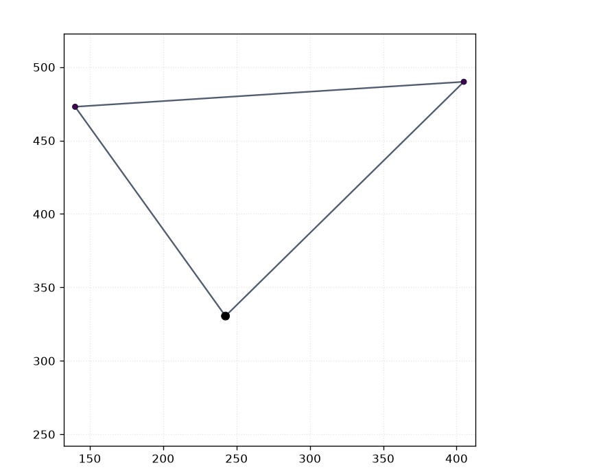
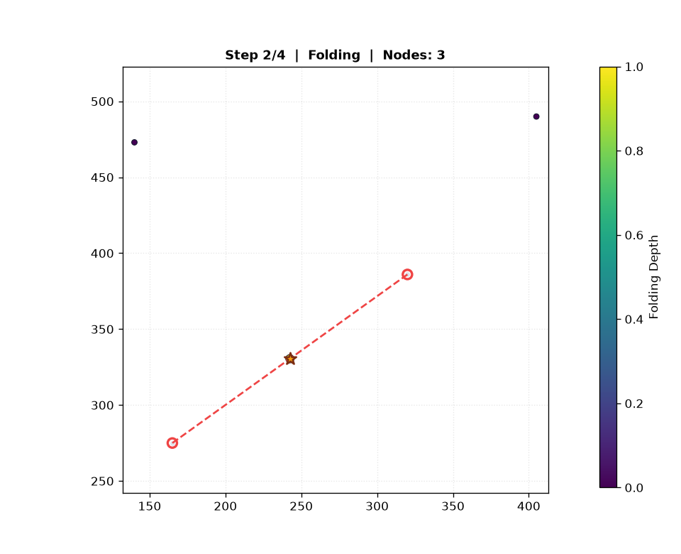
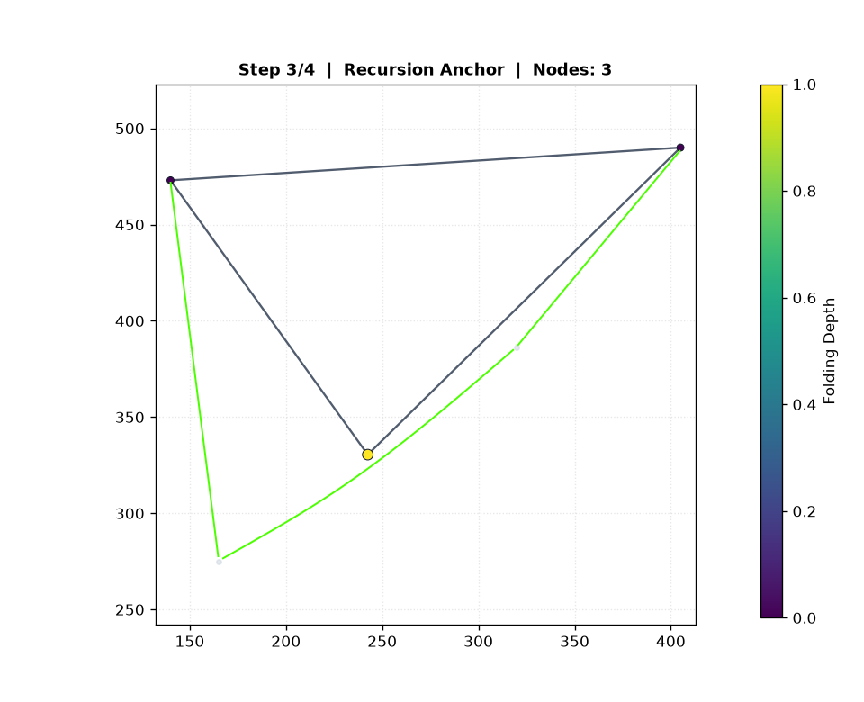

# rfa-tsp <!-- omit from toc -->

The **recursive-fold-algorithm** (RFA) is a recursive algorithm for the metric **travelling-salesman-problem** (TSP). The objective of the TSP is to find a
round trip through a number of cities/locations (more generally referred to as **nodes**). The round trip should be as short as possible. The TSP
is a very hard problem with difficult computational properties (TSP belongs to the NP-hard problem class).

Recursive algorithms naturally split a problem into a series of smaller steps that are easier to solve individually. As such, they're often
very elegant.

## Contents <!-- omit from toc -->

- [Visualization](#visualization)
- [Recursion concept](#recursion-concept)
  - [Folding strategies](#folding-strategies)
  - [Unfolding strategies](#unfolding-strategies)
- [Usage](#usage)
  - [Processing a single TSPLIB instance](#processing-a-single-tsplib-instance)
  - [Processing a random TSP instance](#processing-a-random-tsp-instance)
  - [Visualizing the steps of the algorithm](#visualizing-the-steps-of-the-algorithm)
  - [Benchmarking](#benchmarking)
- [License](#license)

## Visualization

This is how the RFA finds a route for the TSPLIB problem ``pr76``:

Show command that was used to generate the above animation

    ❯ uv run rfa-tsp tsplib:pr76 --seed 16 --export docs/rfa-tsp_tsplib_pr76.gif --export-fps 2-6
    INFO | Instance:           tsplib:pr76 (76 nodes)
    INFO | Folding strategy:   breadth-first
    INFO | Unfolding strategy: breadth-first-2opt
    INFO | Post-uncross:       False
    INFO | Seed:               16
    INFO | Total length:       109335
    INFO | Optimal route:      108159 (overhead of RFA route: +1.09%)
    INFO | Runtime:            0.021s
    INFO | Exporting 148 unique frames to docs\rfa-tsp_tsplib_pr76.gif (fps=2-6, dpi=120)...
    INFO | Export finished: docs\rfa-tsp_tsplib_pr76.gif

## Recursion concept

RFA exploits the fact that the TSP can be trivially solved if there are only 3 nodes, because only a single round trip route exists
for 3 nodes. The solution, a triangle, is self-evident:

This **trivial case** is the **recursion anchor** for the algorithm.

But how to deal with larger problem sizes? The answer is to **fold
nodes**. Folding means that two nodes that are in close proximity to each other are fused into an artificial new node. This new node gets placed in the middle
between the two original nodes and replaces them. By remembering the original nodes it is also possible to reverse such a folding operation later on (referred to as **unfolding**). Of course, folded nodes can be folded again themselves (recursively).
These folding steps can be repeated until the problem size is reduced to a number of 3 nodes.

Let's consider the following TSP instance with 4 nodes:

We can pick a node and its nearest neighbor and fold them. The new node will be placed in the center and remember
the original nodes (the "children"):

At this point, the number of nodes is reduced to 3. This is the trivial case and a preliminary route
can be constructed. The best route for 3 nodes is a simple triangle:

Now we have to reverse the folding.

The key to RFA is that the nodes are now unfolded step by step. Each unfolding
removes a node and replaces it with two new nodes (the original child nodes from which the folded node was constructed). These new nodes can be inserted into the preliminary route in two alternative orders only.

| Bad choice (longer, intersecting) | Good choice (shorter) |
| :---: | :---: |
|  |  |

It is trivial to calculate which option keeps the route shorter. Result:

The complete process can be described as follows:

- **Folding:** Pick a node and fold it with a neighboring node. Repeat folding nodes until the number of nodes has been reduced to 3.
- **Recursion anchor:** Create a preliminary round trip route through the 3 remaining nodes.
- **Unfolding:** Unfold the nodes until the original nodes have been restored. At each unfolding step, insert the new nodes in the preliminary route. Choose the insertion order that gives the shorter route length.

<!--
Images generated with:
uv run rfa-tsp random:default -n 4 -s 0 --export docs/rfa-tsp_concept.png
-->

### Folding strategies

- `FoldingStrategyBreadthFirst` (default): Randomly picks one of the least-folded nodes
  (minimum folding depth) and folds it with its nearest neighbor across all active nodes,
  keeping the folding tree balanced.
- `FoldingStrategyRandomWithNearestNeighbor`: A very simple yet highly efficient method
  which randomly picks a node and folds it with the nearest-neighbor.
- `FoldingStrategyOutsideIn`: The node furthest from the center point is folded with its
  nearest-neighbor. The center point is only calculated once at the beginning.

### Unfolding strategies

- `UnfoldingStrategyBreadthFirst`: The list of folded nodes is processed repeatedly. During each iteration, only
  the nodes with the maximum depth are unfolded.
- `UnfoldingStrategyBreadthFirstWithLocal2Opt` (default): Same as UnfoldingStrategyBreadthFirst, but after each unfolding
  step, a local 2-opt optimization around the inserted nodes is performed.

## Usage

This project uses ``uv`` as package and project manager. See: <https://docs.astral.sh/uv/>

### Processing a single TSPLIB instance

You can select a single TSPLIB instance from the ``TSPLIB/`` folder:

    ❯ uv run rfa-tsp tsplib:a280
    INFO | Instance:           tsplib:a280 (280 nodes)
    INFO | Folding strategy:   breadth-first
    INFO | Unfolding strategy: breadth-first-2opt
    INFO | Post-uncross:       False
    INFO | Seed:               0
    INFO | Total length:       2882
    INFO | Optimal route:      2579 (overhead of RFA route: +11.75%)
    INFO | Runtime:            0.017s

Results will vary slightly when you change the RNG seed:

    ❯ uv run rfa-tsp tsplib:a280 --seed 1
    ... (same as above) ...
    INFO | Seed:               1
    INFO | Total length:       2837
    INFO | Optimal route:      2579 (overhead of RFA route: +10.00%)
    INFO | Runtime:            0.018s

### Processing a random TSP instance

To process a randomly generated set of nodes:

    ❯ uv run rfa-tsp random:your_seed --nodes 50
    INFO | Instance:           random:your_seed (50 nodes)
    INFO | Folding strategy:   breadth-first
    INFO | Unfolding strategy: breadth-first-2opt
    INFO | Post-uncross:       False
    INFO | Seed:               0
    INFO | Total length:       3197
    INFO | Runtime:            0.003s

In this case, ``your_seed`` is a separate RNG seed for generating the random nodes. The
default seed is ``default``, so ``random`` is equal to specifying ``random:default``.

### Visualizing the steps of the algorithm

The folding and unfolding phases can be rendered step-by-step:

    ❯ uv run rfa-tsp tsplib:a280 --renderer matplotlib

The rendering can also be exported as an animation:

    ❯ uv run rfa-tsp tsplib:a280 --export rfa-tsp_tsplib_a280.gif --export-fps 2-6

### Benchmarking

The following command runs a benchmark using a subset of the [TSPLIB95] instances (see ``TSPLIB/`` folder):

    ❯ uv run rfa-tsp-benchmark
    INFO | Folding strategy:   breadth-first
    INFO | Unfolding strategy: breadth-first-2opt
    INFO | Post-uncross:       False
    INFO | Seed:               0
    INFO | Running benchmark for 18 TSPLIB instance(s): ...
    ...
    Instance      Length of optimal route    Length of RFA route  RFA vs. optimum    Runtime
    ----------  -------------------------  ---------------------  -----------------  ---------
    a280                             2579                   2882  +11.75%            0.014s
    berlin52                         7542                   8337  +10.54%            0.003s
    bier127                        118282                 128084  +8.29%             0.008s
    brd14051                       469385                 517022  +10.15%            0.773s
    ch150                            6528                   6900  +5.70%             0.012s
    d18512                         645238                 708935  +9.87%             1.018s
    eil51                             426                    443  +3.99%             0.006s
    pla33810                     66048945               77483437  +17.31%            1.613s
    pla7397                      23260728               26482473  +13.85%            0.357s
    pla85900                    142382641              164304152  +15.40%            4.469s
    pr1002                         259045                 279017  +7.71%             0.080s
    pr107                           44303                  44658  +0.80%             0.006s
    pr439                          107217                 115989  +8.18%             0.023s
    pr76                           108159                 114746  +6.09%             0.004s
    rat783                           8806                   9664  +9.74%             0.039s
    rat99                            1211                   1295  +6.94%             0.006s
    sw24978                        855597                 944301  +10.37%            1.373s
    usa13509                     19982859               22192827  +11.06%            0.774s
    
    Summary (18/18 instances):
      Min overhead:               +0.80%
      Mean overhead (arithmetic): +9.32%
      Mean overhead (geometric):  +9.25%
      Median overhead:            +9.81%
      Max overhead:               +17.31%
      Total runtime:              10.578s

## License

The Recursive-Fold-Algorithm (RFA) was originally conceived and developed by Robert Nitsch in 2010.

This project is licensed under the **MIT License** – see the [LICENSE](LICENSE) file for details.

The benchmark instances in `TSPLIB/` are taken from [TSPLIB95] (Gerhard Reinelt, Universität Heidelberg) and are provided strictly for academic and benchmarking purposes.

[TSPLIB95]: https://comopt.ifi.uni-heidelberg.de/software/TSPLIB95/
