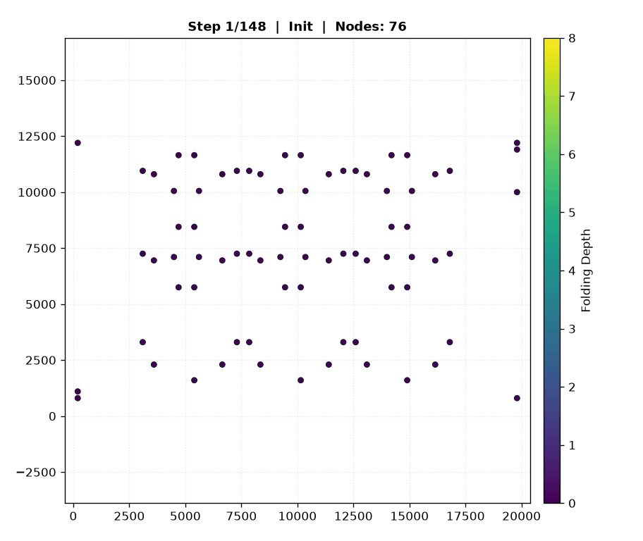
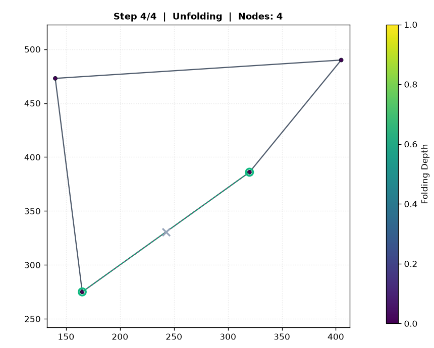

# rfa-tsp <!-- omit from toc -->

[](https://www.python.org/downloads/)
[](LICENSE)
[](https://github.com/rsnitsch/rfa-tsp/actions/workflows/pip-audit.yml)
[](https://github.com/rsnitsch/rfa-tsp/actions/workflows/test.yml)
[](https://github.com/astral-sh/uv)
[](https://github.com/astral-sh/ruff)

The **recursive-fold-algorithm** (RFA) is a recursive heuristic for the **travelling salesman problem** (TSP). While the
folding concept generalizes to any metric TSP, this implementation and the analyses below focus on the **2D Euclidean
TSP**, where geometric coordinates enable $O(n)$ expected runtime and $O(n)$ memory usage.

Recursive algorithms naturally split a problem into a series of smaller steps that are easier to solve individually. As
such, they're often very elegant.

## Contents <!-- omit from toc -->

- [Visualization](#visualization)
- [Recursion concept](#recursion-concept)
  - [Folding strategies](#folding-strategies)
  - [Unfolding strategies](#unfolding-strategies)
- [Algorithmic properties](#algorithmic-properties)
  - [Seed sensitivity](#seed-sensitivity)
    - [Key observations](#key-observations)
  - [Time complexity](#time-complexity)
    - [Empirical scaling](#empirical-scaling)
    - [Algorithmic analysis](#algorithmic-analysis)
  - [Memory complexity](#memory-complexity)
- [Usage](#usage)
  - [Processing a single TSPLIB instance](#processing-a-single-tsplib-instance)
  - [Processing a random TSP instance](#processing-a-random-tsp-instance)
  - [Visualizing the steps of the algorithm](#visualizing-the-steps-of-the-algorithm)
  - [Benchmarking](#benchmarking)
- [License](#license)

## Visualization

This is how the RFA finds a route for the TSPLIB problem `pr76`:



<details>
<summary>Show command that was used to generate the above animation</summary>

Note: Version 1.0.0 was used.

```console
❯ uv run rfa-tsp tsplib:pr76 --seed 16 --export docs/rfa-tsp_tsplib_pr76.gif --export-fps 2-6
INFO | Instance:           tsplib:pr76 (76 nodes)
INFO | Folding strategy:   breadth-first
INFO | Unfolding strategy: breadth-first-2opt
INFO | Post-uncross:       False
INFO | Seed:               16
INFO | Total length:       109335
INFO | Optimal route:      108159 (overhead of RFA route: +1.09%)
INFO | Runtime:            0.021s
INFO | Exporting 148 unique frames to docs\rfa-tsp_tsplib_pr76.gif (fps=2-6, dpi=120)...
INFO | Export finished: docs\rfa-tsp_tsplib_pr76.gif
```

</details>

## Recursion concept

RFA exploits the fact that the TSP can be trivially solved if there are only 3 nodes, because only a single round trip
route exists for 3 nodes. The solution, a triangle, is self-evident:


This **trivial case** is the **recursion anchor** for the algorithm.

But how to deal with larger problem sizes? The answer is to **fold nodes**. Folding means that two nodes that are in
close proximity to each other are fused into an artificial new node. This new node gets placed in the middle between the
two original nodes and replaces them. By remembering the original nodes it is also possible to reverse such a folding
operation later on (referred to as **unfolding**). Of course, folded nodes can be folded again themselves (recursively).
These folding steps can be repeated until the problem size is reduced to a number of 3 nodes.

Let's consider the following TSP instance with 4 nodes:


We can pick a node and its nearest neighbor and fold them. The new node will be placed in the center and remember the
original nodes (the "children"):


At this point, the number of nodes is reduced to 3. This is the trivial case and a preliminary route can be constructed.
The best route for 3 nodes is a simple triangle:


Now we have to reverse the folding.

The key to RFA is that the nodes are now unfolded step by step. Each unfolding removes a node and replaces it with two
new nodes (the original child nodes from which the folded node was constructed). These new nodes can be inserted into
the preliminary route in two alternative orders only.

|              Bad choice (longer, intersecting)               |                     Good choice (shorter)                      |
| :----------------------------------------------------------: | :------------------------------------------------------------: |
|  |  |

It is trivial to calculate which option keeps the route shorter. Result:



The complete process can be described as follows:

- **Folding:** Pick a node and fold it with a neighboring node. Repeat folding nodes until the number of nodes has been
  reduced to 3.
- **Recursion anchor:** Create a preliminary round trip route through the 3 remaining nodes.
- **Unfolding:** Unfold the nodes until the original nodes have been restored. At each unfolding step, insert the new
  nodes in the preliminary route. Choose the insertion order that gives the shorter route length.

<!--
Images generated with:
uv run rfa-tsp random:default -n 4 -s 0 --export docs/rfa-tsp_concept.png
-->

### Folding strategies

- `breadth-first` (default up to v1.0): Randomly picks one of the least-folded nodes (minimum folding depth) and folds
  it with its nearest neighbor across all active nodes, keeping the folding tree balanced.
- `breadth-first-mutual-nn` (default since v1.1): Like `breadth-first`, processes the least-folded nodes first to keep
  the folding tree balanced, but preferentially folds mutual nearest-neighbor pairs (two nodes that are each other's
  nearest neighbor), avoiding asymmetric pairings.
- `random-nn`: A very simple yet highly efficient method which randomly picks a node and folds it with the
  nearest-neighbor.
- `outside-in`: The node furthest from the center point is folded with its nearest-neighbor. The center point is only
  calculated once at the beginning.

### Unfolding strategies

- `breadth-first`: The list of folded nodes is processed repeatedly. During each iteration, only the nodes with the
  maximum depth are unfolded.
- `breadth-first-2opt` (default): Same as `breadth-first`, but after each unfolding step, a local 2-opt optimization
  around the inserted nodes is performed.

## Algorithmic properties

### Seed sensitivity

The `breadth-first-mutual-nn` (default), `breadth-first`, and `random-nn` folding strategies involve randomized
tie-breaking or node selection. Consequently, the quality of the resulting tour can depend on the RNG seed.

To quantify how strongly RFA depends on the seed across different problem sizes, we can evaluate multiple consecutive
seeds (`--trials`) and compare a small instance (`tsplib:pr76`) with large instances (`tsplib:pla7397`,
`tsplib:usa13509`):

| Instance          |  Nodes | Trials | Mean overhead | Std. dev. ($\sigma$) | Best overhead     |
| :---------------- | -----: | -----: | ------------: | -------------------: | :---------------- |
| `tsplib:pr76`     |     76 |  5,000 |        +3.65% |                0.52% | +2.74% (seed 0)   |
| `tsplib:pla7397`  |  7,397 |    300 |       +10.97% |                0.49% | +9.90% (seed 128) |
| `tsplib:usa13509` | 13,509 |    200 |        +9.16% |                0.30% | +8.38% (seed 5)   |


<details>
<summary>Show plots for pla7397 and pr76</summary>


</details>

#### Key observations

- **Tight, symmetric distributions at scale:** On large instances (`pla7397`, `usa13509`), many local fallback and
  tie-breaking steps accumulate into a narrow, roughly symmetric bell curve ($\sigma = 0.30$% on `usa13509`).
- **High single-run reliability:** Because the variance is very low across all problem sizes, even a single RFA run
  produces a highly predictable result without severe bad-luck outliers. Multi-trial sweeps (`--trials`) offer only
  modest gains (~0.8–1.1 percentage points over the mean on large instances) and show rapid diminishing returns.
- **Near-determinism on small instances:** Because mutual nearest-neighbor pairs are geometrically well-defined,
  `breadth-first-mutual-nn` eliminates most of the randomness on small instances. Across 5,000 seeds on `pr76`, RFA
  collapses into just two discrete solutions (+2.74% and +3.95%), with the better one already found on seed 0.

<details>
<summary>Show commands used to generate the above plots</summary>

```console
uv run scripts/generate_seed_sensitivity_plots_for_readme.py
```

</details>

### Time complexity

#### Empirical scaling

Looking at the [benchmark results](#benchmarking) across TSPLIB instances spanning nearly two orders of magnitude in
size reveals a nearly constant runtime per node:

| Instance   | Nodes ($n$) | Mean runtime | Time per node |
| :--------- | ----------: | -----------: | ------------: |
| `pr1002`   |       1,002 |       0.061s |       61.2 µs |
| `pla7397`  |       7,397 |       0.401s |       54.2 µs |
| `usa13509` |      13,509 |       0.859s |       63.6 µs |
| `d18512`   |      18,512 |       1.085s |       58.6 µs |
| `sw24978`  |      24,978 |       1.580s |       63.3 µs |
| `pla33810` |      33,810 |       1.819s |       53.8 µs |
| `pla85900` |      85,900 |       4.953s |       57.7 µs |

Increasing the problem size by a factor of ~11.6 (from `pla7397` to `pla85900`) increases runtime by a factor of ~12.4 —
closely matching **linear $O(n)$ scaling** in practice.

#### Algorithmic analysis

Both phases perform exactly $n - 3$ steps:

- **Folding — expected $O(n)$, worst-case $O(n^2)$:** In each step, a node is folded with its nearest neighbor using a
  dynamic 2D spatial hash grid (`SpatialGrid`). Whenever the number of active nodes halves, the grid is rebuilt with
  coarser cells so that cell density stays roughly constant; across the entire run, all rebuilds sum to $O(n + n/2 +
  n/4 + \dots) = O(n)$. For reasonably distributed 2D point sets, each nearest-neighbor query inspects only a constant
  number of neighboring cells ($O(1)$ expected), yielding **$O(n)$ expected total time** for `breadth-first-mutual-nn`,
  `breadth-first` and `random-nn` (and $O(n \log n)$ for `outside-in` due to its max-heap).

  In the **worst case**, however, pathological point distributions (e.g., almost all nodes tightly clustered in a tiny
  area while a few distant outliers stretch the bounding box) cause many nodes to collapse into a single grid cell or
  force the ring search to scan many empty cells. Each nearest-neighbor query then degrades to $O(n)$, resulting in
  **$O(n^2)$ worst-case time**. This is a deliberate trade-off of using a lightweight spatial hash grid to support fast
  dynamic insertions and deletions at every folding step, rather than an inherent limitation of the RFA concept itself;
  density-adaptive structures such as an R-tree or quadtree handle skewed distributions more robustly in practice, but
  raise the expected time complexity from $O(n)$ to $O(n \log n)$.

- **Unfolding — strictly $O(n)$:** The tour is maintained as a circular doubly-linked structure (`nxt`/`prv`
  dictionaries), so replacing a folded node with its two children takes $O(1)$ time. With `breadth-first-2opt`, the
  local 2-opt refinement operates only on a fixed-size neighborhood window (`radius=5`, at most 12 nodes), which also
  runs in $O(1)$ per step. Thus, unfolding is **strictly $O(n)$** even in the worst case.

### Memory complexity

RFA has **strictly $O(n)$ space complexity** — even in the worst case — because Euclidean distances are computed on the
fly from node coordinates rather than stored in an $n \times n$ distance matrix:

- **Folding tree:** Exactly $n - 3$ folded nodes are created in addition to the $n$ original nodes, totaling $2n - 3$
  nodes.
- **Spatial hash grid (`SpatialGrid`):** Stores only the currently active nodes ($\le n$) and their cell assignments,
  using $O(n)$ space.
- **Tour representation:** The circular doubly-linked structure (`nxt`/`prv`) holds at most $n$ entries.

In contrast, algorithms that require a full distance matrix scale as $O(n^2)$ in memory — for `pla85900`
($n = 85{,}900$), a `float64` distance matrix alone would require ~59 GB of RAM, whereas RFA processes the instance with
a small linear memory footprint.

## Usage

This project uses `uv` as package and project manager. See: <https://docs.astral.sh/uv/>

### Processing a single TSPLIB instance

You can select a single TSPLIB instance from the `TSPLIB/` folder:

```console
❯ uv run rfa-tsp tsplib:a280
INFO     | rfa-tsp version:    1.1.0
INFO     | Timestamp:          2026-11-27 11:43:58
INFO     | Instance:           tsplib:a280 (280 nodes)
INFO     | Folding strategy:   breadth-first-mutual-nn
INFO     | Unfolding strategy: breadth-first-2opt
INFO     | Post-uncross:       False
INFO     | Weighted centroids: False
INFO     | Seed:               0
INFO     | Total length:       2860
INFO     | Optimal route:      2579 (overhead of RFA route: +10.90%)
INFO     | Runtime:            0.015s
INFO     | Runtime per node:   52.501µs
```

Results will vary slightly when you change the RNG seed:

```console
❯ uv run rfa-tsp tsplib:a280 --seed 1
...
INFO     | Seed:               1
INFO     | Total length:       2862
INFO     | Optimal route:      2579 (overhead of RFA route: +10.97%)
...
```

### Processing a random TSP instance

To process a randomly generated set of nodes:

```console
❯ uv run rfa-tsp random:your_seed --nodes 50
INFO     | rfa-tsp version:    1.1.0
INFO     | Timestamp:          2026-11-27 11:45:15
INFO     | Instance:           random:your_seed (50 nodes)
INFO     | Folding strategy:   breadth-first-mutual-nn
INFO     | Unfolding strategy: breadth-first-2opt
INFO     | Post-uncross:       False
INFO     | Weighted centroids: False
INFO     | Seed:               0
INFO     | Total length:       3197
INFO     | Runtime:            0.003s
INFO     | Runtime per node:   65.000µs
```

In this case, `your_seed` is a separate RNG seed for generating the random nodes. The default seed is `default`, so
`random` is equal to specifying `random:default`.

### Visualizing the steps of the algorithm

The folding and unfolding phases can be rendered step-by-step:

```console
❯ uv run rfa-tsp tsplib:a280 --renderer matplotlib
```

The rendering can also be exported as an animation:

```console
❯ uv run rfa-tsp tsplib:a280 --export rfa-tsp_tsplib_a280.gif --export-fps 2-6
```

### Benchmarking

The following command runs a benchmark using a subset of the [TSPLIB95] instances (see `TSPLIB/` folder):

```console
❯ uv run rfa-tsp-benchmark --cooldown 5 --trials 10
INFO     | rfa-tsp version:    1.1.0
INFO     | Timestamp:          2026-11-27 11:01:36
INFO     | Folding strategy:    breadth-first-mutual-nn
INFO     | Unfolding strategy:  breadth-first-2opt
INFO     | Post-uncross:        False
INFO     | Weighted centroids:  False
INFO     | Seed:                0
INFO     | Trials per instance: 10
INFO     | Running benchmark for 18 TSPLIB instance(s): a280, berlin52, bier127, brd14051, ...
...
Instance      Optimal     Mean RFA  Mean vs. opt.    Std     Mean runtime    Mean runtime per node
----------  ---------  -----------  ---------------  ------  --------------  -----------------------
a280             2579       2856.3  +10.75%          ±0.83%  0.015s          52.362µs
berlin52         7542       7734.0  +2.55%           ±0.00%  0.003s          52.502µs
bier127        118282     126178.4  +6.68%           ±1.04%  0.007s          58.160µs
brd14051       469385     511991.3  +9.08%           ±0.17%  0.826s          58.763µs
ch150            6528       6921.4  +6.03%           ±1.69%  0.009s          57.921µs
d18512         645238     702822.7  +8.92%           ±0.11%  1.085s          58.608µs
eil51             426        452.7  +6.27%           ±0.38%  0.003s          62.598µs
pla33810     66048945   75668983.3  +14.57%          ±0.15%  1.819s          53.814µs
pla7397      23260728   25790846.5  +10.88%          ±0.63%  0.401s          54.224µs
pla85900    142382641  160896445.6  +13.00%          ±0.16%  4.953s          57.658µs
pr1002         259045     275942.5  +6.52%           ±0.90%  0.061s          61.159µs
pr107           44303      44693.6  +0.88%           ±0.42%  0.006s          54.554µs
pr439          107217     115465.5  +7.69%           ±1.33%  0.025s          57.667µs
pr76           108159     111647.2  +3.23%           ±0.62%  0.004s          56.710µs
rat783           8806       9535.8  +8.29%           ±0.53%  0.043s          54.381µs
rat99            1211       1289.1  +6.45%           ±2.91%  0.005s          54.809µs
sw24978        855597     933939.1  +9.16%           ±0.26%  1.580s          63.268µs
usa13509     19982859   21809555.9  +9.14%           ±0.37%  0.859s          63.560µs

Summary (18/18 instances, 10 trials each):
  Min mean overhead:          +0.88%
  Mean overhead (arithmetic): +7.78%
  Median mean overhead:       +7.99%
  Max mean overhead:          +14.57%
  Total runtime:              117.044s (11.70437s / trial)
```

## License

The recursive-fold-algorithm (RFA) was originally conceived and developed by Robert Nitsch in 2010.

This project is licensed under the **MIT License** – see the [LICENSE](LICENSE) file for details.

The benchmark instances in `TSPLIB/` are taken from [TSPLIB95] (Gerhard Reinelt, Universität Heidelberg) and are
provided strictly for academic and benchmarking purposes.

<!--
This README was formatted with:
uvx --with mdformat-gfm --with mdformat-dollarmath mdformat --wrap 120 README.md
-->

[tsplib95]: https://comopt.ifi.uni-heidelberg.de/software/TSPLIB95/
